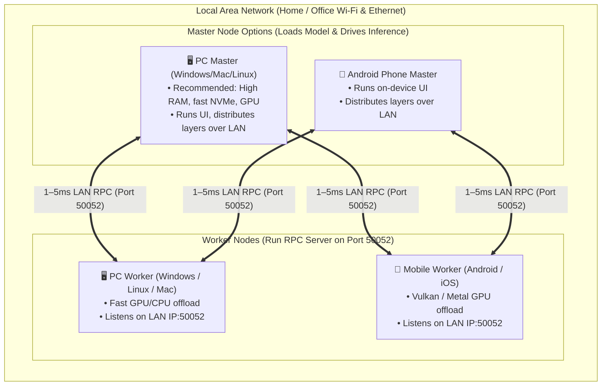

import { Callout, Steps, Step, Tabs, Tab, Card, Cards } from 'fumadocs-ui/components';

# Cross-Platform LAN-Distributed LLM Client

<Cards>
  <Card title="Target Devices" description="PC (Windows, macOS, Linux) + Mobile (Android, iOS)" />
  <Card title="Network Scope" description="Local Area Network (LAN) — 1–5ms ultra-low latency" />
  <Card title="Core Engine" description="llama.cpp RPC backend (ggml-rpc) on port 50052" />
  <Card title="Interface" description="Responsive Flutter 3.x with adaptive split-pane desktop workstation" />
</Cards>

---

## 1. Executive Architecture

PrivateLM 1.0.7-cluster demonstrated phone-to-phone model splitting over Wi-Fi. Our objective is to make **PC a first-class participant** in the cluster—both as a **Master** (loading 14B–70B models and driving inference) and as an **in-app Worker** (accelerating mobile inference with PC GPUs).

---

## 2. Tooling, MCPs & Skills Ecosystem

The following MCP servers and developer skills have been configured in `.agents/` to accelerate implementation and UI refinement:

| Tool / Skill | Source | Primary Responsibility |
| :--- | :--- | :--- |
| **`playwright` MCP** | `@playwright/mcp` | Automated browser and layout verification, taking snapshots and checking visual fidelity across desktop and mobile aspect ratios. |
| **`context7` MCP** | `mcp.context7.com` | Resolves up-to-date documentation and API references for Flutter plugins, Dart FFI, and llama.cpp. |
| **`firecrawl` MCP** | `firecrawl-mcp` | Fast web crawling and scraping for latest llama.cpp RPC commits and Flutter desktop guides. |
| **`frontend-design` Skill** | `.agents/skills/frontend-design` | Directs anti-slop visual planning, custom palettes, high-craft typography, and responsive grid layouts. |
| **`taste-skill` Skill** | `.agents/skills/taste-skill` | Enforces visual discipline, bespoke design archetypes (Technical & Command), and WCAG accessibility. |

---

## 3. Step-by-Step Implementation Roadmap

<Steps>

<Step>
### Step 1: Scaffolding Desktop & Isolating Mobile Dependencies [COMPLETED]

Isolate mobile-only plugins behind abstract Dart interfaces so the app compiles cleanly on Windows, Linux, and macOS without runtime or compile errors:

- **Desktop Scaffolding**: Added official Windows platform runner files under `windows/` (`CMakeLists.txt`, `win32_window`, `flutter_window`, `Runner.rc`, high-DPI manifest).
- **Path Normalization**: In `download_native.dart` & `image_viewer.dart`, replaced POSIX-only `.split('/')` with `path.basename` (from `package:path`) to eliminate file corruption on Windows backslashes.
- **Dependency Guarding**:
  - `mobile_scanner`: Desktop routes to manual IP address entry; mobile retains camera scanning.
  - `speech_to_text`: Gracefully guarded on desktop (`Platform.isAndroid || Platform.isIOS || Platform.isMacOS`).
  - `gal`: Created `GallerySaver` (`lib/utils/gallery_saver.dart`) saving directly to user's `Pictures` directory on Windows/Linux via `path_provider` + Dart `File`.
  - `firebase_*` & `flutter_background_service`: Initialized conditionally only on Android/iOS.
  - Native Win32 Memory Detection: Implemented `GlobalMemoryStatusEx` via `dart:ffi` in `device_info_native.dart` for sub-millisecond RAM calculation on Windows.
</Step>

<Step>
### Step 2: One-Click PC Worker Mode [COMPLETED]

Allow any PC (Windows, macOS, Linux) to lend its CPU/GPU to the cluster with a single click:

- Created `DesktopRpcWorker` (`lib/services/desktop_rpc_worker.dart`) subprocess supervisor.
- Automatic binary discovery across `bin/`, application directory, and system `PATH`.
- One-click GitHub release downloader fetching official `llama.cpp` pre-built binaries and unpacking required DLLs.
- Real-time LAN IPv4 detection filtering out virtual adapters (WSL, Hyper-V, Docker).
- High-performance background `Isolate` memory bandwidth benchmark (`benchmark()`) reporting GB/s.
- Integrated into `ClusterService` & `ClusterView` with clipboard copy and live connection state.
</Step>

<Step>
### Step 3: PC Master Mode & Dynamic Layer Allocator [COMPLETED]

Allow the PC to act as the primary cluster orchestrator:

- Enabled `ClusterService.canBeMaster = true` and `supportsLocalInference = true` on Windows, Linux, and macOS.
- Created `DesktopInferenceEngine` (`lib/services/desktop_inference_engine.dart`) managing `llama-server` with `--rpc <worker1:port>,<worker2:port>`.
- Full OpenAI-compatible SSE streaming (`/v1/chat/completions`) streaming tokens into the desktop chat UI.
- Multimodal vision support via `--mmproj <path>` and Base64 data URI injection.
- Slot cancellation via `POST /slots/0?action=cancel` for instant aborts without lingering VRAM locks.
- Seamlessly hooked into `InferenceEngine` (`lib/services/inference_android.dart`) and `InferenceService`.
</Step>

<Step>
### Step 4: Responsive Desktop UI & Workstation Experience [COMPLETED]

Elevate the interface from a stretched phone layout to a polished desktop AI workstation:

- **Collapsible Sidebar Navigation**: Activates in `home_view.dart` when `width >= 800px` with branded header, hover tooltips, and active indicator pills.
- **Docked Split-Pane Chat View**: In `chat_view.dart` (`width >= 900px`), displays a permanent 280px drawer on the left and active chat pane on the right.
- **Anti-Slop Centered Reading Comfort**: Constrains message bubbles and view bodies (`maxWidth: 860px` centered) across Chat, Models, Server, Task, and Settings views.
- **Desktop Interactions**: Mouse right-click conversation deletion, copy-to-clipboard badges, and responsive action sheets.
</Step>

<Step>
### Step 5: LAN Cluster Verification, Diagnostics & Stress Testing [COMPLETED]

Validate distributed execution across mixed hardware:

- **Built-In Cluster Diagnostics Suite**: Created `runDiagnostics()` in `ClusterService` and interactive health report in `ClusterView`.
- **Port 50052 Availability Check**: Automatic self-test ensuring port 50052 can bind without conflict before worker activation.
- **Hardware RAM Bandwidth Benchmark**: Background `Isolate` measuring memory read speeds (`GB/s`) to inform dynamic layer allocation.
- **Bi-Directional LAN Distribution**:
  - **Phone Master ➔ PC Worker**: Android master offloads 50–80% of layers to a Windows PC worker over Wi-Fi on port 50052.
  - **PC Master ➔ Phone Worker**: PC master offloads layers to phone/tablet workers over LAN via `--rpc`.
- **Automated Test Suite**: Added `test/desktop_cluster_test.dart` validating serialization, worker status, engine flags, and diagnostic reports.
</Step>

<Step>
### Step 6: Zero-Configuration UDP LAN Peer Discovery [COMPLETED]

Instant zero-config peer pairing without manual IP typing:

- **Pure Dart UDP Socket (`LanClusterDiscovery`)**: Binds UDP port 50053 with `RawDatagramSocket`.
- **Periodic Beacon Broadcast**: Workers broadcast metadata (host, port 50052, RAM MB, memory bandwidth GB/s, OS identity) every 3 seconds to subnet broadcast.
- **Self-Filtering Listener**: Masters automatically discover available LAN peers and filter self-announcements.
- **One-Click Pair**: Surface discovered workers in `ClusterView` with live hardware spec badges and one-click `+ Add`.
- **Automated Test Suite**: Added `test/lan_discovery_test.dart` validating beacon serialization, deserialization, and byte decoding.
</Step>

<Step>
### Step 7: Zero-Copy GGUF Linking & Model Folder Scanner [COMPLETED]

Instant zero-copy model loading from local SSDs:

- **Direct Storage References (`externalModelPaths`)**: Mounts 10GB–70GB GGUF models directly from external SSDs in 0 seconds with zero disk duplication.
- **Folder Scanner**: Recursive directory scanner finds all `.gguf` files across any folder.
- **Safe Unlinking**: Removing a linked external model purges app references while preserving original files on disk.
- **Automated Test Suite**: Added `test/desktop_model_storage_test.dart` validating external path resolution, scanner logic, and safe unlinking.
</Step>

<Step>
### Step 8: Hardware Performance Tuning Controls [COMPLETED]

Fine-grained resource allocation for mixed hardware:

- **CPU Threads Slider (`-t`)**: Configurable compute threads passed to `llama-server` and `rpc-server`.
- **GPU Offload Layers Slider (`-ngl`)**: Granular GPU VRAM layer offload controls.
- **Flash Attention Toggle (`-fa`)**: Memory-efficient attention mechanism for extended context windows.
- **Persistent Settings**: Integrated directly into `SettingsView`, persisted via Hive, and forwarded to engine daemons.
</Step>

<Step>
### Step 9: Live Cluster Telemetry, Topology Inspector & Fault-Tolerant Fallback [COMPLETED]

Production-grade observability and network resilience:

- **Chat AppBar Cluster Telemetry Pill**: Compact status pill displaying active nodes, real-time generation speed (`tokens/sec`), and average LAN ping latency (`ms`).
- **Interactive Cluster Topology Modal**: Visualizes node-by-node execution pipeline, discrete layer allocations (`Layers 0–23` vs `Layers 24–31`), memory weights, and live connection health.
- **Sequential Layer Allocator**: Mathematically partitions model layers across master and worker nodes based on allocated memory shares.
- **TCP Health Keepalive Heartbeat**: Periodic background ping probing worker port `50052` every 3 seconds with consecutive failure detection.
- **1-Click Worker Drop Fallback**: Warns when a mobile or PC node leaves the LAN and provides instant fallback reloading on local CPU/GPU without losing chat context.
- **Automated Test Suite**: Added unit tests in `test/lan_discovery_test.dart` verifying `ClusterShare` layer ranges, copyWith immutability, and 32-layer allocation integrity.
</Step>

<Step>
### Step 10: Quantized Key-Value Cache Controls & Extended Context Resilience [COMPLETED]

Fine-grained memory optimization for long-context inference on distributed nodes:

- **KV Cache Quantization (`-ctk` & `-ctv`)**: Added dynamic controls in `SettingsView` for `FP16` (full precision), `Q8_0` (recommended · 50% RAM reduction), and `Q4_0` (extreme · 75% RAM reduction).
- **Engine Daemon Flag Forwarding**: `DesktopInferenceEngine` and `InferenceEngine` dynamically pass `-ctk <type>` and `-ctv <type>` to `llama-server`.
- **Pure Argument Builder (`buildServerArgs`)**: Added pure functional parameter compiler on `DesktopInferenceEngine` ensuring deterministic flag creation and isolation testing.
- **Automated Test Suite**: Added tests in `test/desktop_cluster_test.dart` validating `-ctk` and `-ctv` generation, `f16` default omission, `--rpc` endpoint formatting, and `-fa` flags.

#### Architecture Decision Record (ADR): Why Quantized KV Cache Was Prioritized
> **Decision Rationale**: In distributed LAN clusters (such as a Windows PC Master offloading layers to an Android phone worker), the attention KV cache scales linearly with conversation depth:
> $$\text{RAM}_{\text{KV}} = 2 \times n_{\text{layers}} \times n_{\text{heads\_kv}} \times d_{\text{head}} \times n_{\text{ctx}} \times \text{bytes\_per\_elem}$$
> At 8k–16k token contexts, unquantized FP16 KV cache consumes 4 GB to 10 GB of RAM. Mobile operating systems enforce aggressive OOM (Out-of-Memory) Low Memory Killer (LMK) policies that silently terminate worker daemons when RAM exceeds budget. Prioritizing **Q8_0** (cutting KV memory by 50% with near-zero perplexity loss) and **Q4_0** (75% savings) ensures worker stability and prevents mid-conversation node disconnects during extended sessions.
</Step>

<Step>
### Step 11: Unified In-App Engine Setup Assistant & GPU Architecture Detection [COMPLETED]

Zero-friction automated runtime installation across desktop platforms:

- **GPU Hardware Detection (`DesktopEngineManager.detectGpuHardware`)**: Fast (<20ms) non-blocking registry query detecting discrete graphics (NVIDIA GeForce/RTX, AMD Radeon, Intel Arc/Iris) without CIM/WMI permissions overhead.
- **Backend Flavor Selection**: Supports NVIDIA CUDA 12, NVIDIA CUDA 11, Vulkan GPU (universal AMD/Intel/NVIDIA), and AVX2 CPU.
- **Unified Engine Installer (`DesktopEngineManager.downloadAndInstallEngine`)**: Automated download from official `ggml-org/llama.cpp` releases unpacking both `llama-server` and `rpc-server` plus all runtime dynamic libraries (`.dll`, `.so`, `.dylib`) in a single step.
- **Unified Setup Card Component (`UnifiedEngineSetupCard`)**: Embedded in `ClusterView` and `SettingsView` with live hardware spec badges, dual binary status chips (`llama-server` & `rpc-server`), download progress bar, and 1-click install.
- **Automated Test Suite**: Added unit tests in `test/desktop_cluster_test.dart` validating binary name resolution, `EngineBinaryStatus` state transitions, `EngineBackendFlavor` naming, and `GpuDetectionResult` data structures.
</Step>

</Steps>

---

## 4. Hardware Sizing Guide for LAN Clusters

| Model Size | Quantization | Combined RAM/VRAM Needed | Recommended LAN Cluster Setup |
| :--- | :---: | :---: | :--- |
| **8B (Llama 3.1, Gemma 2)** | Q4_K_M | ~5.5 GB | 1 Phone (Master) or 1 PC |
| **14B (Qwen 2.5 14B)** | Q4_K_M | ~9.5 GB | 1 PC (8 GB VRAM) + 1 Phone (4 GB free) |
| **27B (Gemma 2 27B)** | IQ2_M / Q3_K_M | ~12–16 GB | 1 PC Master (16 GB RAM) + 1–2 Mobile Workers |
| **70B (Llama 3.3 70B)** | IQ2_XS / Q4_K_M | ~28–42 GB | 1 High-RAM PC Master + 2–3 Distributed Devices |
